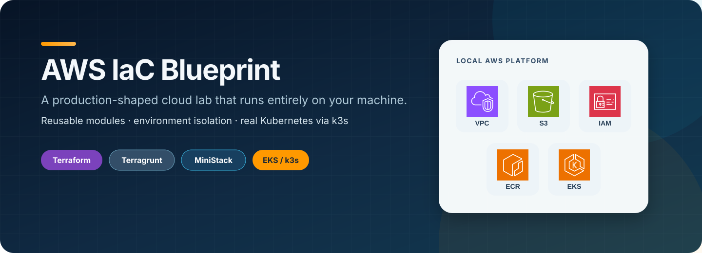
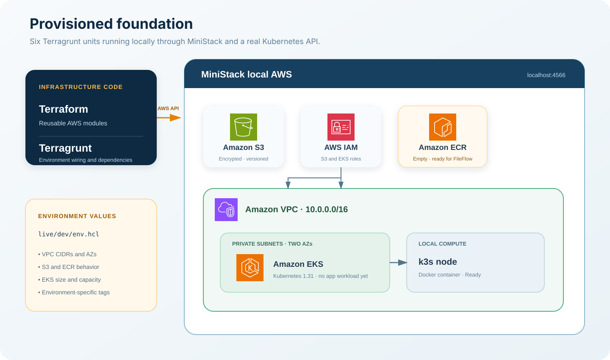
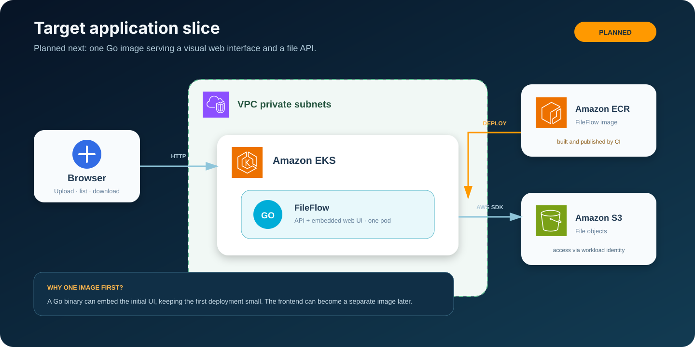

<p align="center">
  
</p>

<p align="center">
  
  
  
  
  
  
</p>

<p align="center">
  A portfolio and learning project for building production-shaped AWS infrastructure locally,<br />
  with reusable Terraform modules, Terragrunt orchestration, and a real k3s Kubernetes cluster.
</p>

## At a glance

| Unit | Purpose | Current local result |
|---|---|---|
| `vpc` | Public/private network across two AZs | VPC, 4 subnets, routing, IGW |
| `s3` | Versioned and encrypted object storage | `blueprint-dev-raw` |
| `iam/s3` | Least-privilege bucket access | Role, policy, attachment |
| `iam/eks` | EKS control-plane and node permissions | 2 roles and required policies |
| `ecr` | Secure application image registry | `blueprint-dev-fileflow` |
| `eks` | Kubernetes control plane and managed nodes | EKS 1.31 backed by local k3s |

Everything can be validated and applied without a real AWS account.

## Architecture

<p align="center">
  
</p>

The same Terraform modules can target MiniStack locally or AWS by changing provider configuration. Environment capacity and behavior stay in `live/<env>/env.hcl`; reusable implementation stays outside the environment directories.

### FileFlow application path

<p align="center">
  
</p>

The first FileFlow version is implemented as one Go binary serving both a visual web interface and a file API. It already runs as a non-root local container with replaceable storage; ECR publishing, the EKS workload, workload identity, and S3 are the next infrastructure integrations.

## What this project demonstrates

- **Clear responsibility boundaries:** Terraform builds resources; Terragrunt wires environments and dependencies.
- **Environment isolation:** CIDRs, storage behavior, registry retention, and EKS capacity come from `env.hcl`.
- **Service-specific IAM:** S3 and EKS permissions are independent modules rather than one central IAM module.
- **Local EKS:** MiniStack exposes the EKS API and runs Kubernetes through a real k3s container.
- **Safe image registry:** immutable ECR tags, scan on push, AES256 encryption, and lifecycle retention.
- **Demonstrable workload:** responsive FileFlow UI and tested upload, list, download, delete, and health APIs in one Go binary.
- **Reproducible workflow:** format, validate, plan, apply, inspect, and destroy using the same dependency graph.

## Configuration flow

```text
global.hcl                 project-wide identity
    ↓
live/dev/env.hcl           environment values
    ↓
_common/<unit>             source, inputs, dependencies
    ↓
terraform/modules/<unit>   reusable AWS resources
    ↓
MiniStack locally          or AWS in a real account
```

The current graph contains six units. `vpc`, `s3`, `ecr`, and `iam/eks` can start independently; `iam/s3` consumes the bucket ARN, while `eks` consumes private subnet IDs and EKS role ARNs.

## Quick start

```bash
cp .env.example .env
source .env

docker compose -f ministack/docker-compose.yml up -d

terragrunt --non-interactive \
  --working-dir terragrunt/live/dev \
  run --all -- validate

terragrunt --working-dir terragrunt/live/dev run --all -- plan
terragrunt --working-dir terragrunt/live/dev run --all -- apply
```

Inspect Kubernetes without installing `kubectl` on the host:

```bash
docker exec ministack-eks-000000000000-us-east-1-blueprint-dev \
  kubectl get nodes -o wide
```

## Documentation

| Guide | Contents |
|---|---|
| [Getting started](docs/getting-started.md) | Prerequisites, apply, inspection, Kubernetes commands, and cleanup |
| [Architecture](docs/architecture.md) | Design decisions, dependency graph, modules, environments, and AWS comparison |
| [FileFlow](applications/fileflow/README.md) | Application API, Docker usage, and runtime configuration |

## Roadmap

- [x] Local AWS APIs with MiniStack
- [x] VPC, S3, and service-specific IAM
- [x] EKS 1.31 with a local k3s node
- [x] ECR repository for FileFlow images
- [x] FileFlow API in Go with an embedded visual web interface
- [x] Tested non-root local container image
- [ ] Immutable image publishing to ECR
- [ ] Kubernetes workload, service, health checks, and ingress
- [ ] Workload identity for least-privilege S3 access
- [ ] CI/CD, observability, security checks, and updated visual evidence

## Workflow

Work is integrated through `develop → pull request → main`. `main` represents the latest reviewed and reproducible state; visual evidence is refreshed after each reproducible phase.

## License and visual assets

Source code is available under the [MIT License](LICENSE). Architecture diagrams use the official [AWS Architecture Icons](https://aws.amazon.com/architecture/icons/).

---

Built by [Tiago Gonçalves de Castro](https://github.com/tiagogcastro) · [Portfolio](https://tiagogcastro.com.br) · [LinkedIn](https://www.linkedin.com/in/tiagogoncalvesdecastro/)
