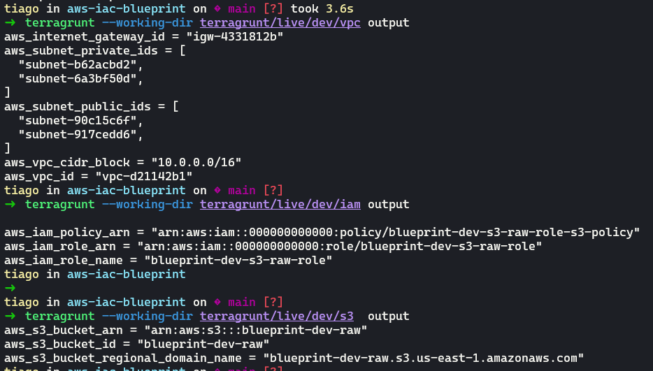

# AWS IaC Blueprint

> Portfolio / learning template. Infrastructure as Code with Terraform and Terragrunt on AWS.
> No real AWS account required. Validate and apply everything locally with MiniStack.


---

## What this is

A template that demonstrates how to structure a real-world IaC project where **all environments share the exact same infrastructure configuration**. The only difference between `dev`, `staging`, and `prod` is the values declared in each environment's `env.hcl`. Modules and orchestration logic are written once and reused everywhere.

- **Reusable Terraform modules** - no hardcoded values, no provider declarations, no `terraform {}` block; clean, testable units
- **Terragrunt orchestration** - injects provider, backend, and version constraints per environment via `root.hcl`
- **Environment isolation** - `_common/` holds module logic; `live/<env>/` holds one `env.hcl` per environment; adding `staging/` or `prod/` is one new file, zero module changes
- **MiniStack integration** - full `apply` -> inspect -> `destroy` cycle with no AWS account, token, or costs

---

## Resources provisioned

### VPC - `terraform/modules/vpc`

Network isolation layer. Provisions:

- **VPC** with DNS hostnames and DNS resolution enabled
- **Internet Gateway** attached to the VPC
- **Public subnets** (one per AZ) - routed to the internet gateway
- **Private subnets** (one per AZ) - isolated, no internet route
- **Route tables** with associations for both tiers

All networking values (CIDR blocks, availability zones) are required inputs with no defaults, so each environment declares its own addressing in `env.hcl`.

### S3 - `terraform/modules/s3`

Generic object storage bucket. Provisions:

- **S3 bucket** - name pattern: `<project>-<env>-<suffix>` (e.g., `blueprint-dev-raw`)
- **Versioning** - configurable per call
- **Server-side encryption** - AES256 at rest
- **Public access block** - all four controls enabled

The `layer` input accepts `raw`, `processed`, or `curated` and is validated at plan time.

### IAM - `terraform/modules/iam/{s3,eks}`

IAM is split into independent service modules:

- **`iam/s3`** - service role, least-privilege bucket policy, and attachment
- **`iam/eks`** - control-plane and node roles, AWS-managed policy attachments, and an ECR pull policy

Each module keeps its roles, policies, and attachments in separate files. There is no intermediate IAM composition module.

### EKS - `terraform/modules/eks`

Local Kubernetes cluster backed by k3s. Provisions:

- **EKS cluster** - Kubernetes 1.31 on the private VPC subnets
- **Managed node group** - `t3.medium`, scaling from 1 to 2 nodes

IAM resources are provided by the IAM module rather than created inside EKS.

---

## Project structure

```
.
├── terraform/
│   └── modules/
│       ├── vpc/          # VPC, subnets, route tables, IGW
│       ├── s3/           # S3 bucket (versioning, encryption, public-access block)
│       ├── iam/
│       │   ├── s3/       # S3 role, policy, and attachment
│       │   └── eks/      # EKS roles, policies, and attachments
│       └── eks/          # EKS cluster and managed node group
│
├── terragrunt/
│   ├── global.hcl             # project_name, owner
│   ├── root.hcl               # generates versions.tf, provider.tf, backend.tf per module
│   ├── _common/               # module inputs shared across all environments
│   │   ├── vpc/terragrunt.hcl
│   │   ├── s3/terragrunt.hcl
│   │   ├── iam/
│   │   │   ├── s3/terragrunt.hcl
│   │   │   └── eks/terragrunt.hcl
│   │   └── eks/terragrunt.hcl
│   └── live/
│       └── dev/
│           ├── env.hcl              # region, account ID, CIDRs, local AWS endpoint
│           ├── vpc/terragrunt.hcl
│           ├── s3/terragrunt.hcl
│           ├── iam/
│           │   ├── s3/terragrunt.hcl
│           │   └── eks/terragrunt.hcl
│           └── eks/terragrunt.hcl
│
├── ministack/
│   └── docker-compose.yml     # local AWS emulator
│
├── .env.example               # template - copy to .env and fill in values
└── .gitignore
```

---

## Config hierarchy

| File | Scope | Contains |
|------|-------|----------|
| `global.hcl` | All environments | `project_name`, `owner` |
| `root.hcl` | Every module | Provider, backend, version constraints |
| `_common/<unit>/terragrunt.hcl` | Every environment | Module source, inputs, dependencies |
| `live/<env>/env.hcl` | One environment | Region, account ID, CIDRs, skip-flags, `extra_tags` |
| `live/<env>/<unit>/terragrunt.hcl` | One environment x unit | Includes `root.hcl` and the corresponding `_common` configuration |

**Adding a new environment** = create `live/staging/` with one `env.hcl` and one entry file per module. Zero changes to Terraform modules or `root.hcl`.

### Dependency order

Terragrunt reads `dependency` blocks and builds the execution graph automatically:

- `vpc`, `s3`, and `iam/eks` have no upstream dependencies and can run in parallel
- `iam/s3` depends on `s3` because its policy needs the bucket ARN
- `eks` depends on `vpc` for private subnet IDs and on `iam/eks` for role ARNs

Dependency blocks carry mock outputs so `validate` and `plan` work before their dependencies are applied.

---

## Tag strategy

| Tag | Source | Applied to |
|-----|--------|------------|
| `Project` | `global.hcl` -> `default_tags` | all resources |
| `Environment` | `env.hcl` -> `default_tags` | all resources |
| `Owner` | `global.hcl` -> `default_tags` | all resources |
| `ManagedBy` | `root.hcl` -> `default_tags` | all resources |
| `CostCenter` | `env.hcl` -> `extra_tags` | all resources |
| `Name` | each resource block | individual resource |
| `Layer` | S3 module | S3 bucket only |

Base tags (`Project`, `Environment`, `Owner`, `ManagedBy`) are applied via `provider default_tags` in `root.hcl`. They appear on every resource without any module code.

---

## Prerequisites

| Tool | Minimum | Install |
|------|---------|---------|
| Terraform | 1.5.0 | `brew install terraform` |
| Terragrunt | 0.50.0 | `brew install terragrunt` |
| Git | any | required for `get_repo_root()` |
| Docker | any | required for local MiniStack and its k3s cluster |

> `get_repo_root()` requires a git repository. Run `git init` once before using Terragrunt commands.

---

## Validate and plan (no credentials needed)

```bash
# Initialise git (required once)
git init

# Format
terraform fmt -recursive terraform/
terragrunt hcl format --working-dir terragrunt/

# Validate all modules
terragrunt --working-dir terragrunt/live/dev run --all -- validate

# Plan all modules (no apply, no AWS calls)
terragrunt --working-dir terragrunt/live/dev run --all -- plan
```

---

## MiniStack - full apply without a real AWS account

MiniStack emulates AWS APIs locally. Terraform calls go to `localhost:4566` instead of real AWS. The `AWS_ENDPOINT_URL` variable is the only switch. When set, `root.hcl` injects `s3_use_path_style = true` and an `endpoints {}` block into the generated provider automatically.

```bash
# 1. Copy and configure environment variables
cp .env.example .env

# 2. Source environment variables
source .env

# 3. Pull the pinned MiniStack image
docker compose -f ministack/docker-compose.yml pull

# 4. Start MiniStack
docker compose -f ministack/docker-compose.yml up -d

# 5. Confirm it is healthy
docker compose -f ministack/docker-compose.yml ps

# 6. Inspect the local emulator health
curl --fail http://localhost:4566/_ministack/health

# 7. Plan all modules (review before applying)
terragrunt --working-dir terragrunt/live/dev run --all -- plan

# 8. Apply all modules in dependency order
terragrunt --working-dir terragrunt/live/dev run --all -- apply

# 9. Inspect Terragrunt outputs per module
terragrunt --working-dir terragrunt/live/dev/vpc output
terragrunt --working-dir terragrunt/live/dev/s3 output
terragrunt --working-dir terragrunt/live/dev/iam/s3 output
terragrunt --working-dir terragrunt/live/dev/iam/eks output
terragrunt --working-dir terragrunt/live/dev/eks output
```



```bash
# 10. Inspect via AWS CLI
aws --endpoint-url=http://localhost:4566 s3 ls
aws --endpoint-url=http://localhost:4566 iam list-roles --query 'Roles[].RoleName'
aws --endpoint-url=http://localhost:4566 ec2 describe-vpcs --query 'Vpcs[].{ID:VpcId,CIDR:CidrBlock}'
aws --endpoint-url=http://localhost:4566 eks list-clusters
aws --endpoint-url=http://localhost:4566 eks describe-nodegroup \
  --cluster-name blueprint-dev \
  --nodegroup-name blueprint-dev-nodes

# Inspect Kubernetes without installing kubectl on the host
docker exec ministack-eks-000000000000-us-east-1-blueprint-dev \
  kubectl get nodes

# 11. Clean up
terragrunt --working-dir terragrunt/live/dev run --all -- destroy
```

To target a real AWS account: unset `AWS_ENDPOINT_URL` and configure `~/.aws/credentials` normally.

> MiniStack needs access to `/var/run/docker.sock` to create the local k3s cluster used by EKS in a later step. This grants the container control over the local Docker daemon and must only be used in a trusted development environment.

---

## Environment variables reference

| Variable | Local value | Purpose |
|----------|-------------|---------|
| `AWS_ACCESS_KEY_ID` | `test` | Local dummy credential |
| `AWS_SECRET_ACCESS_KEY` | `test` | Same |
| `AWS_DEFAULT_REGION` | `us-east-1` | Must match `env.hcl` |
| `AWS_ENDPOINT_URL` | `http://localhost:4566` | Redirects AWS API calls to MiniStack |

---

## Author

Tiago Gonçalves de Castro - [github.com/tiagogcastro](https://github.com/tiagogcastro) · [linkedin.com/in/tiagogoncalvesdecastro](https://www.linkedin.com/in/tiagogoncalvesdecastro/)
